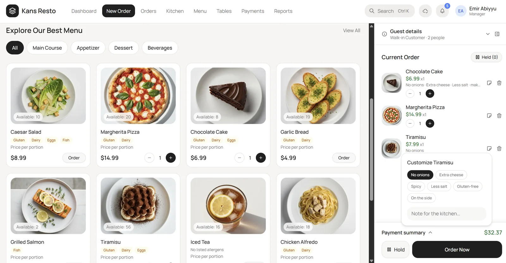
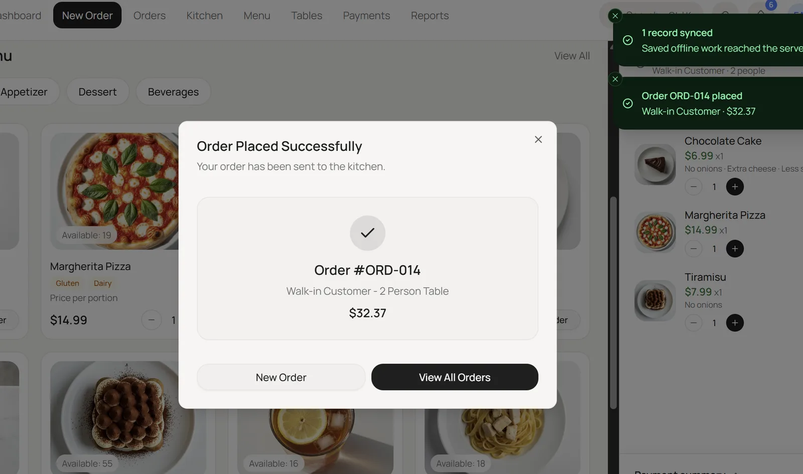
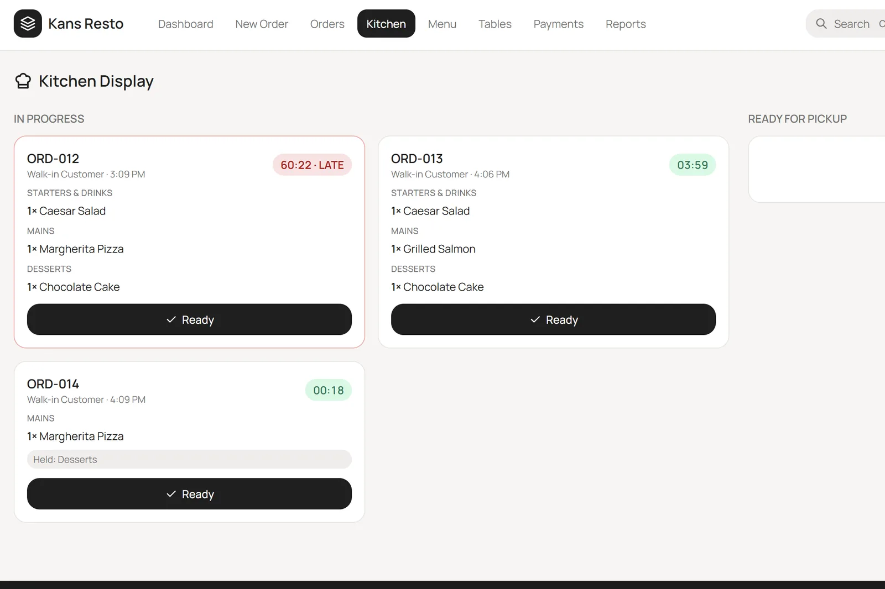
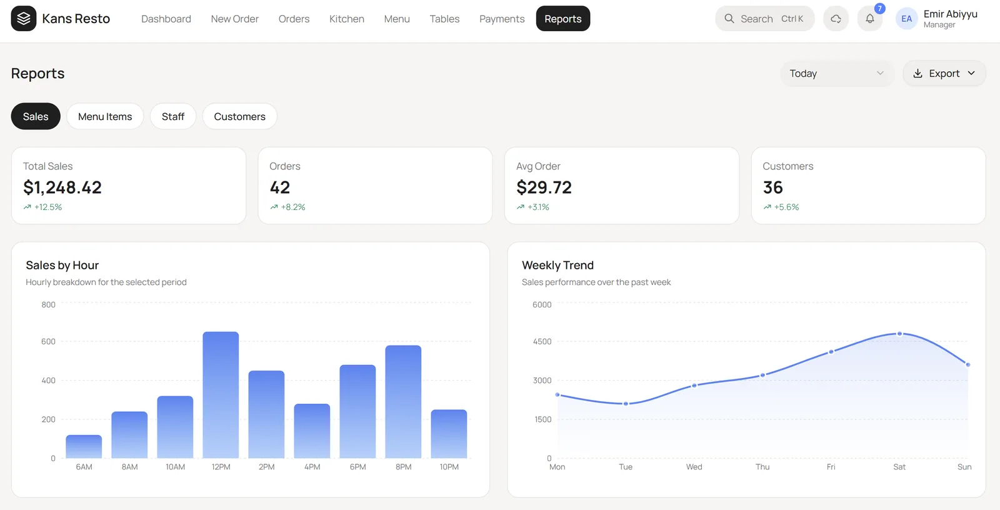

<div align="center">

# 🍽️ Kans Resto

**A modern restaurant POS: take orders, fire courses to the kitchen, split bills, close the shift and keep working when the Wi-Fi drops.**

[](https://nextjs.org/)
[](https://react.dev/)
[](https://www.typescriptlang.org/)
[](https://tailwindcss.com/)
[](LICENSE)

[**Live demo: Login**](https://v0-restaurant-pos-project.vercel.app/login/) · [**Dashboard**](https://v0-restaurant-pos-project.vercel.app/) · [Report a bug](https://github.com/nithinpjohn/Restaurant-POS-application/issues) · [Sponsor](#-sponsors--partners)



</div>

---

## 📸 Screenshots

| New order, modifiers and pinned checkout | Order placed, synced toast |
|---|---|
|  |  |

| Kitchen display with timers and held courses | Reports and analytics |
|---|---|
|  |  |

---

## ✨ Why Kans Resto

- **Built for the floor, not the demo.** The order panel stays fixed, the checkout buttons are never off-screen, and Ctrl+K finds anything.
- **Safety and compliance are part of the flow.** Allergen warnings, age checks, manager PIN approvals, an audit log and food-safety logs are built in.
- **Keeps working offline.** Orders and cash sales are queued on the device and sync when the connection returns.
- **Looks good.** One consistent design language: cream surfaces, rounded cards, Manrope type, and toasts for every event.

---

## 🧩 Features

### 🛒 Cart and checkout
- Menu browsing by category with live stock counts and allergen tags
- Per-item modifiers (no onions, extra cheese, gluten-free…) and kitchen notes
- Undo on remove, **hold and resume** parked orders
- Coupon codes with minimum-spend rules
- **Collapsible, resizable order panel** with a pinned total and Order Now button

### 💳 Payments and receipts
- Split bill: equal, by seat, or custom amounts
- Tips with pooling, cash **change calculator**, cash-drawer count
- Gift cards, loyalty points, mobile and card payments (Luhn and expiry validation)
- Tax lines (State and Service), printable or emailable receipts
- Payments require an **open shift**

### 🍳 Kitchen and operations
- **Kitchen Display** (`/kitchen`) with live timers and late alerts
- **Course firing**: starters go first, mains and desserts are held until fired
- Allergy banners on tickets, shared order state across tabs
- Inventory with low-stock and out-of-stock alerts, one-click restock

### 🛡️ Control and compliance
- Roles: manager, cashier, server
- **Manager PIN approval** for voids, refunds, deletes and audit access, with lockout after 3 wrong tries
- **Age check** for 18+ items (date of birth is not stored)
- Guest **allergen warnings** against every item in the cart
- Searchable, exportable **audit log**
- Idle **session timeout**

### 📈 Back office
- Open and close shifts with a numbered **Z-report** (CSV and print)
- Voids and refunds recorded against the shift
- **E-invoice export** (JSON and XML)
- **Food safety**: temperature logs with overdue alerts, expiry batches and a daily summary
- Sales reports: by hour, weekly trend, menu items, staff, customers

### 🔔 Experience
- Notification panel and `/notifications` page with unread badge
- **Ctrl+K command search** for menu items, orders and pages
- Skeleton and loading states throughout
- **Offline mode**: queue, status chip, banner, auto-sync and a "Work offline (test)" switch

---

## 🚀 Tech stack

| Area | Choice |
|---|---|
| Framework | Next.js 16 (App Router), React 19, TypeScript |
| Styling | Tailwind CSS v4, shadcn/ui, Manrope |
| Icons and feedback | Tabler Icons, Sonner toasts, cmdk |
| Charts | Recharts |
| State | React context providers, persisted to `localStorage` |
| API | Next.js Route Handlers (`/api/sync` demo endpoint) |

---

## 📦 Getting started

**Prerequisites:** Node.js 18+ and npm.

```bash
git clone https://github.com/nithinpjohn/Restaurant-POS-application.git
cd Restaurant-POS-application
npm install
npm run dev
```

Open <http://localhost:3000/login>.

```bash
npm run build   # production build
npm start       # serve the build
npx tsc --noEmit  # type check
```

### Demo data to try
| What | Value |
|---|---|
| Manager PIN | `1234` |
| Coupons | `WELCOME10`, `LUNCH15` (min $15), `FLAT5` (min $20) |
| Gift cards | `GIFT50`, `GIFT20` |
| Roles | Switch Manager / Cashier / Server from the profile menu |
| Age-restricted items | Craft Beer, House Red Wine |

---

## 🏗️ Project structure

```
app/
├── (auth)/login/            # Sign in
├── (dashboard)/             # Everything behind the providers
│   ├── page.tsx             # Dashboard
│   ├── new-order/  orders/  kitchen/  menu/  tables/
│   ├── payment/  reports/  shift/  food-safety/
│   └── notifications/  audit-log/
└── api/sync/                # Demo sync endpoint (in-memory)
components/
├── layout/  notifications/  auth/  audit/
├── orders/  inventory/  shift/  food-safety/  sync/
├── payment/  menu/  ui/     # ui = shadcn/ui
lib/                         # money, coupons, allergens, kitchen, einvoice, routes…
hooks/                       # useNow and friends
docs/screenshots/            # README images
```

---

## ⚠️ Project status

This is a **front-end demo with a local-first design**, not a production system yet.

- Data lives in each browser's `localStorage`. The only server piece is a demo `/api/sync` endpoint that keeps records in memory with no authentication.
- Roles and the manager PIN are enforced in the browser only and must move server-side.
- E-invoice output is a generic format, not certified for any tax authority.
- Card payments are simulated. Gift cards, tax rates and temperature ranges are example values.
- Only order creation and sales are queued offline; later status changes stay local.

## 🔮 Roadmap

- [ ] Database (Postgres) and real authentication with server-side permissions
- [ ] Sync order status changes, voids and refunds
- [ ] Real payment provider integration
- [ ] Country-specific e-invoicing
- [ ] Service worker for fully offline page loads
- [ ] Multi-location and staff scheduling
- [ ] Receipt printer support

---

## 🤝 Contributing

1. Fork the repository
2. Create a branch: `git checkout -b feature/your-feature`
3. Run `npx tsc --noEmit` and commit your changes
4. Push and open a Pull Request

Please read [`CLAUDE.md`](CLAUDE.md) for the project's commit rules.

---

## 💖 Sponsors & partners

Kans Resto is built and maintained by [Evalogical](https://evalogical.com). If it saves you time, or you run a restaurant and want it adapted, there are ways to help:

- ⭐ **Star** the repo to help others find it
- 🏢 **Sponsor a feature**: roadmap items above (payments, e-invoicing, database and auth) can be built for your needs
- 🤝 **Partner or pilot**: we are looking for restaurants to test it on the floor

Sponsors and partners are credited here. To get involved, email **[info@evalogical.com](mailto:info@evalogical.com)**.

---

## 👨‍💻 Developer

**Nithin** · [Evalogical](https://evalogical.com)
- GitHub: [@nithinpjohn](https://github.com/nithinpjohn)
- Email: [info@evalogical.com](mailto:info@evalogical.com)

## 📄 License

MIT. See [LICENSE](LICENSE).

## 🙏 Acknowledgments

[Next.js](https://nextjs.org/) · [shadcn/ui](https://ui.shadcn.com/) · [Tailwind CSS](https://tailwindcss.com/) · [Recharts](https://recharts.org/) · [Tabler Icons](https://tabler.io/icons) · [Sonner](https://sonner.emilkowal.ski/) · [cmdk](https://cmdk.paco.me/)

<div align="center">

**Made with ❤️ by Nithin at Evalogical** · ⭐ Star the repo if you find it useful

</div>
